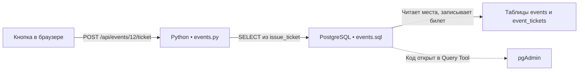

# Где что менять в Campus Threads

Для начала выбери одно небольшое изменение. Например, поменяй текст кнопки или посмотри, какие мероприятия вернёт база. Ниже указано, где это сделать и какой результат искать.

| Что хочешь изменить | Где открыть | Что увидишь после правки |
| --- | --- | --- |
| Текст «Получить бесплатный пропуск» | [views.js](pilot/assets/views.js), найди эту фразу через Ctrl+F | Надпись в карточке мероприятия. Сохрани файл и обнови страницу. |
| Цвет, отступы и размер текста | [pilot.css](pilot/assets/pilot.css), ищи `.event-card` | Оформление карточек. Сохрани файл и обнови страницу. |
| Название, дату, место или лимит одного мероприятия | При создании в **Мероприятия → Создать мероприятие**. Для существующей записи в pgAdmin → **Schemas → public → Tables → events** | Карточка мероприятия и количество доступных пропусков. |
| Кто может публиковать мероприятия | Пункт **5** в меню Windows, [organizers.sql](server/sql/organizers.sql) | У назначенного пользователя появляется кнопка «Создать мероприятие». |
| Кто может удалять чужие публикации | Пункт **6** в меню Windows, [moderation.sql](server/sql/moderation.sql) | Кнопка удаления появляется там, где действует роль модератора. |
| Какие посты показывает лента | [posts.sql](server/sql/posts.sql), функция `feed_page` | Состав ленты после выполнения функции в pgAdmin и обновления страницы. |
| Когда можно записаться и как считается остаток мест | [events.sql](server/sql/events.sql), функции `events_page` и `issue_ticket` | Список мероприятий и результат регистрации. Первая функция читает афишу, вторая выдаёт билет. |
| Как работает поиск, профиль и подписка | [people.sql](server/sql/people.sql) | Результаты поиска, данные профиля или поведение подписки. |
| Сколько записей видно на странице | [pagination.py](server/pagination.py), значение `Query(30, ge=1, le=50)` | Меняется размер страницы ленты и афиши. После правки перезапусти Python. |
| Правила хранения сессий, проверки кода и попыток | [accounts.sql](server/sql/accounts.sql) и [auth.py](server/auth.py) | PostgreSQL хранит записи и счётчики. Python создаёт коды, проверяет хеши и выдаёт cookie. |
| Регистрация по адресу @kbtu.kz без письма | `AUTH_MODE=domain` в `.env`, [domain_registration.sql](server/sql/domain_registration.sql) | Прямая регистрация для пилота. Почту можно подтвердить позже, сохранив профиль. |
| Вход через корпоративный Microsoft | [microsoft.py](server/microsoft.py) и [microsoft.sql](server/sql/microsoft.sql) | Python проверяет ответ Microsoft, PostgreSQL связывает аккаунт КБТУ с профилем. |

## Как связаны четыре части



Браузер показывает экран. Python принимает HTTP-запрос, проверяет сессию и передаёт в PostgreSQL номер мероприятия и ID пользователя. PostgreSQL блокирует нужную строку, проверяет места и возвращает результат. В pgAdmin можно открыть те же функции, проверить их результат и изменить код.

- **Таблица** хранит данные. Например, `public.events` хранит мероприятия.
- **Представление** сохраняет запрос, который читается как таблица. Например, `public.v_post_details` считает лайки и ответы.
- **Функция** возвращает результат. Например, `SELECT * FROM campus_api.feed_page(1)` возвращает строки ленты.
- **Процедура** вызывается через `CALL`. Например, `CALL campus_api.update_bio(1, 'Учу SQL')` меняет описание пользователя с ID 1.

## Открой и проверь код в pgAdmin

1. Убедись, что применена [миграция](README.md#запуск-на-windows). Если используешь подготовленную локальную PostgreSQL, её адрес `127.0.0.1:55432`, база `campus_threads_pilot`, пользователь `campus_local`. Пароль можно посмотреть в своём локальном `.env`.
2. В pgAdmin нажми правой кнопкой на **campus_threads_pilot → Query Tool**. Выполни запросы ниже и посмотри вкладку **Data Output**. В примере `1` — ID пользователя, от лица которого проверяется результат. Для вкладки подписок подставь ID существующего пользователя и `TRUE` вторым параметром.

   ```sql
   SELECT current_database();
   SELECT version FROM public.campus_migrations ORDER BY version;
   SELECT post_id, author, content
   FROM campus_api.feed_page(1, FALSE, 3);
   ```

   Если база ещё пуста, создай аккаунт и опубликуй один тред через приложение, потом повтори запрос. Версия схемы должна включать строку `7`.

3. Чтобы увидеть **установленный в базе** код, разверни **Schemas → campus_api → Functions**, выбери `feed_page` и открой вкладку **SQL**. Ещё один способ в Query Tool:

   ```sql
   SELECT pg_get_functiondef(
       'campus_api.feed_page(integer, boolean, integer, timestamptz, integer)'::regprocedure
   );
   ```

4. Для правки открой исходный [posts.sql](server/sql/posts.sql) через **Open File** в Query Tool. Измени тело нужной функции, сохрани файл и выполни её полный блок `CREATE OR REPLACE FUNCTION ... $$;`. Выполни исходный `SELECT` ещё раз, затем обнови сайт. Имя функции, типы параметров и возвращаемые столбцы связывают её с Python, поэтому для первой правки меняй только тело. Если эксперимент не понравился, верни старое тело в файле и снова выполни блок. Сохранённый файл понадобится для другой базы или следующего развёртывания. [Панель Query Tool](https://www.pgadmin.org/docs/pgadmin4/latest/query_tool_toolbar.html), [CREATE OR REPLACE FUNCTION](https://www.postgresql.org/docs/current/sql-createfunction.html)

### Первое изменение в SQL

В [posts.sql](server/sql/posts.sql) найди функцию `feed_page`. Внутри блока `WHERE` после строки `WHERE p.parent_post_id IS NULL` добавь строку:

```sql
          AND NOT p.is_anonymous
```

Выполни изменённый блок функции и проверь ленту с обычным и анонимным тредом. Останется обычный тред. Затем удали добавленную строку, сохрани файл и снова выполни блок. Так можно увидеть эффект правки SQL без перезапуска FastAPI.

### Почему на следующей странице нет дублей

В ленте новые записи идут первыми. Когда нажимаешь «Дальше», приложение передаёт дату и ID последнего поста. Функция `feed_page` берёт записи строго раньше этой пары. ID задаёт порядок даже для двух постов с одинаковой датой. В афише тот же принцип работает по возрастанию даты. Код проверки курсора и передачи его в браузер находится в [pagination.py](server/pagination.py).
