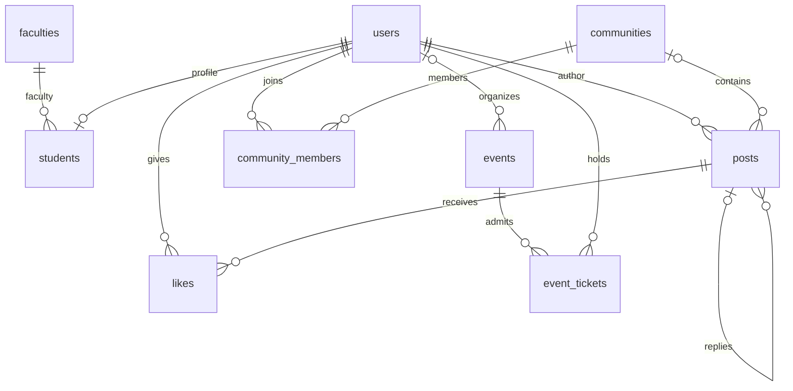

# База данных Campus Threads

Эта папка позволяет восстановить структуру PostgreSQL без доступа к облачной базе и без пользовательских данных. Она относится к работающему приложению FastAPI. Отдельное учебное демо PGlite описано в `README-demo.md`.

| Файл | Что содержит |
| --- | --- |
| `schema.sql` | Актуальная структура версии 9: таблицы, связи, ограничения, индексы, представления, функции, процедуры и триггеры. |
| `reference_data.sql` | Шесть факультетов и номера применённых миграций. Пользователей, паролей, сессий, постов и билетов нет. |
| `../server/manage.py` | Порядок миграций — основной способ создания и дальнейшего обновления БД. |
| `../server/schema/`, `../server/sql/`, `../site/sql/` | Исходные SQL-файлы миграций. Ранние версии описывают историю, итоговая структура находится в `schema.sql`. |

## Как восстановить через pgAdmin

Требуется PostgreSQL 18 и новая пустая база, например `campus_threads_review`.

1. В pgAdmin открой свой сервер PostgreSQL. Создай базу: **Databases → Create → Database**, имя `campus_threads_review`.
2. Открой **Query Tool** именно для новой базы. Через **Open File** открой `schema.sql` и выполни весь файл.
3. Затем открой и выполни `reference_data.sql` в той же базе.
4. Проверь результат:

```sql
SELECT current_database();
SELECT version FROM public.campus_migrations ORDER BY version;
SELECT count(*) AS faculties FROM public.faculties;
SELECT count(*) AS users FROM public.users;
```

Ожидается: миграции 1–9, 6 факультетов, 0 пользователей. Схемы `public` и `campus_api` появятся после обновления дерева объектов. Файлы выполняются по порядку один раз в пустой базе.

Укажи подключение к этой базе в своём `.env`, установи зависимости и запусти приложение по инструкции основного `README.md`. Рабочие данные появятся при регистрации и действиях пользователей. Секреты подключения в GitHub не добавляются.

## Альтернативный способ: только миграции

Вместо импорта двух файлов можно создать пустую БД, указать её в локальном `DATABASE_URL` и выполнить:

```powershell
python -m server.manage migrate
```

Команда создаст ту же структуру и справочники. Выбирай один из двух способов первоначального создания. После восстановления снимка миграции распознают версии 1–9 и смогут применять будущие обновления.

## Основные связи

Диаграмма упрощена для защиты; полный состав объектов находится в SQL.



`community_members` связывает пользователей и сообщества и хранит роль внутри сообщества. `event_tickets` связывает пользователя и мероприятие. Ограничение уникальности не даёт одному пользователю получить два билета на одно событие.

## Что считается «БД в GitHub»

SQL, справочники, миграции и инструкция позволяют преподавателю восстановить БД. Картинка связей дополняет эти файлы. Каталог работающего PostgreSQL, облачные реквизиты, `.env` и реальные пользовательские записи для этого не нужны.

Снимок создан из новой локальной базы после применения миграций, затем восстановлен в другую пустую базу. Пользовательские данные из Neon не экспортировались. Результат восстановления находится в `tests/reports/database-restore.json`.

При изменении схемы сначала добавляется новая миграция, затем обновляются SQL-снимок и справочники. Экспорт структуры выполняется через `pg_dump --schema-only --no-owner --no-privileges`. В этом снимке убраны только клиентские строки `\restrict` / `\unrestrict`, чтобы его можно было выполнять через Query Tool; определения объектов сохранены.
